I build iOS apps in Swift and SwiftUI. I care about the small stuff: how a swipe feels, what an empty state says, whether the app needs the network at all.

 

**[Decima](https://github.com/PriyanshuNamdev/Decima)**

Cleans up your Photos library. It finds screenshots, exact duplicates, look-alike shots and large videos, then lets you clear them in bulk or swipe through them one at a time. Everything runs on your phone, and no photo ever leaves it.

SwiftUI, PhotoKit, Vision, no third-party code

 
 

**[Intent](https://github.com/PriyanshuNamdev/Intent)**

An alarm you can't snooze half-asleep. To turn it off you have to finish a short challenge first, so by the time it stops you're actually awake.

SwiftUI, Swift Playgrounds

 
 

**[NuDerm](https://github.com/NuDerm)**

A skincare app that looks at your skin with the camera, checks what's in your products, and tracks your daily routine.

SwiftUI, computer vision

 
 

I start in Figma, then move to code early and work out the rest on a real device. I reach for Apple's own frameworks before anything else, and I'd rather ship three screens that feel right than ten that half work.

Swift, SwiftUI, UIKit, SwiftData, Xcode, Figma, Supabase, Git

[LinkedIn](https://www.linkedin.com/in/priyanshu-namdev/)
